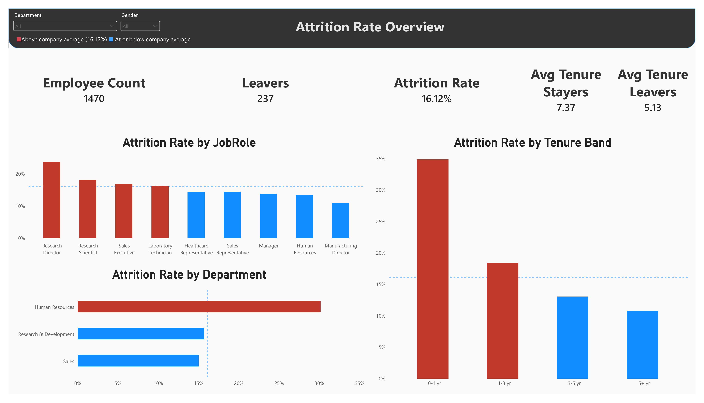
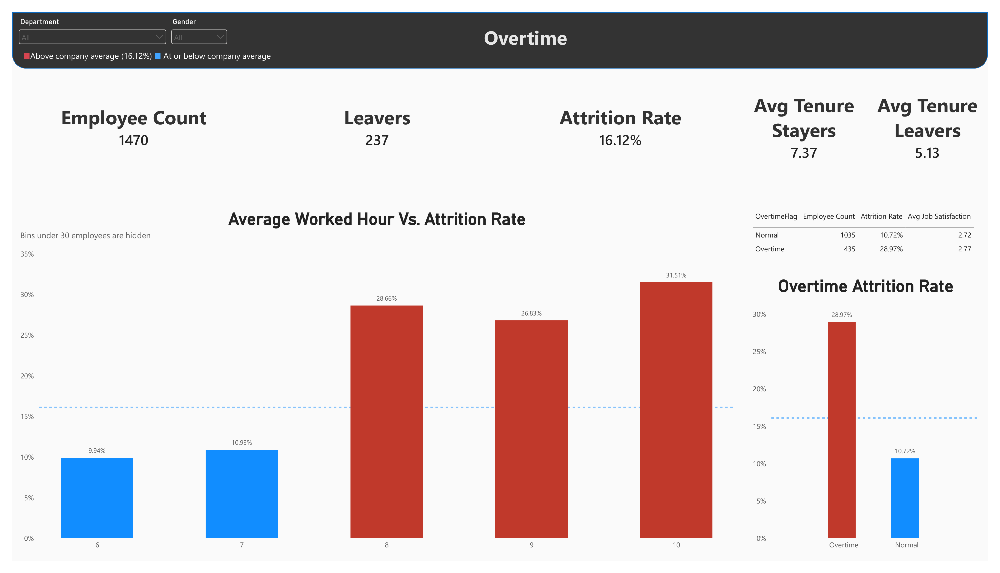
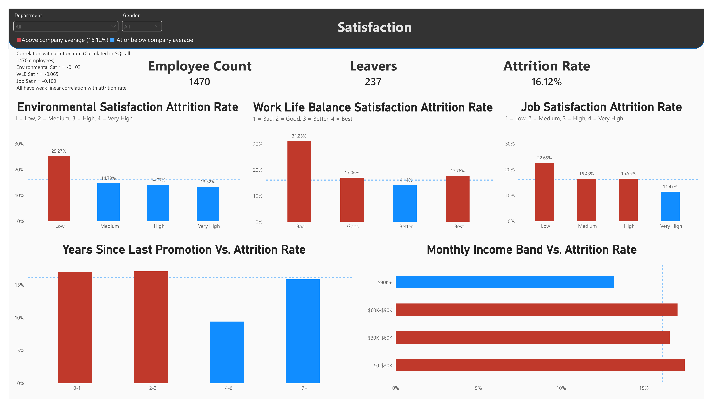
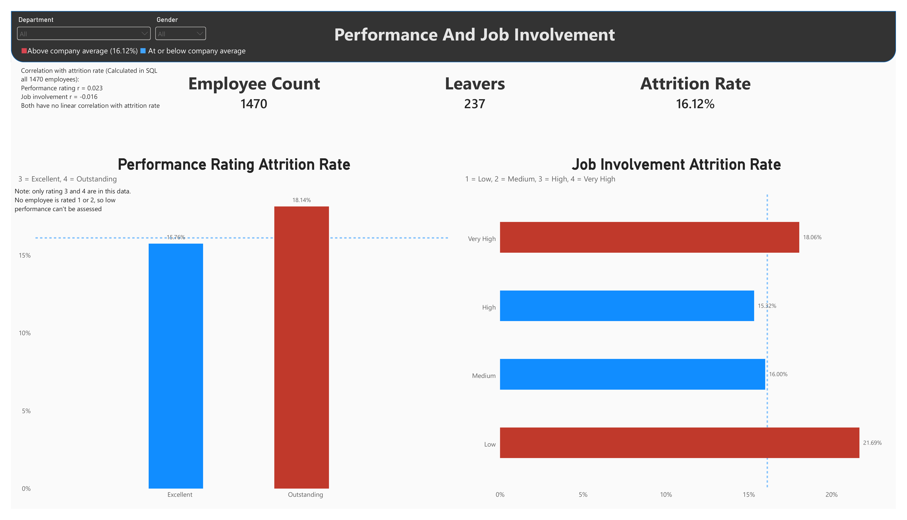

# Employee Attrition Risk Dashboard

**HR Analytics | Excel & Power Query | PostgreSQL | Power BI**

> **Scenario (fictional):** *From: Director of HR. Subject: Attrition is up, need answers before the Q4 retention planning meeting.*
>
> Turnover has climbed over the last two quarters and the board is asking questions. Before we commit budget to a retention program next year, I need to understand *why* people are leaving, not guess. Which departments, job roles, and tenure groups are losing people fastest? Is it burnout, are the employees working the longest hours the ones leaving? Does it come down to low satisfaction, or is pay and promotion stagnation the bigger driver? Are low performance ratings and low manager involvement connected to attrition? I need this as a dashboard I can walk the leadership team through, plus a short memo with the main drivers and a recommendation.

This is a practice project built on a public dataset. The scenario is fictional, and so is the data.

---

## Business questions

1. Where is attrition highest: which department, job role, and tenure group?
2. Do employees who work overtime leave at a higher rate?
3. Are low satisfaction and pay or promotion stagnation related to attrition?
4. Are low performance ratings and low manager involvement related to attrition?

## Key findings

Company-wide attrition is **16.12%** (237 of 1,470 employees).

| Question | Finding |
|---|---|
| **1. Where is attrition highest?** | **Department:** Human Resources, 30.16% (63 employees). **Job role:** Research Director, 23.75% (80 employees); Research Scientist, Sales Executive, and Laboratory Technician are also above average. **Tenure:** 0–1 years, 34.88% (215 employees), falling steadily to 10.81% for 5+ years. |
| **2. Overtime** | Employees averaging more than 8 hours a day leave at **28.97%** (435 employees), against **10.72%** for everyone else (1,035). The effect is a step, not a slope: 9.94% and 10.93% at 6 and 7 average hours, versus 28.66%, 26.83%, and 31.51% at 8, 9, and 10. Average job satisfaction is almost the same in both groups (2.77 vs. 2.72). |
| **3. Satisfaction, pay, promotion** | Satisfaction is **weakly** related (r = −0.065 to −0.102), with the effect concentrated at the lowest rating: work-life balance Bad 31.25%, environment Low 25.27%, job satisfaction Low 22.65%. Time since last promotion and income band show no consistent pattern. |
| **4. Performance and involvement** | No linear relationship (performance r = 0.023, involvement r = −0.016). Only ratings 3 and 4 exist in the data, so low performers cannot be assessed. Involvement is U-shaped (Low 21.69%, Very High 18.06%, versus 16.00% and 15.32% in between); the groups at the ends are small. |

**Recommendations:** address workload first, support new hires through their first three years, target follow-up at the lowest satisfaction ratings, and validate the small hot spots (HR, Research Director) before investing. Based on this data, retention budget should not go to pay increases, promotion fast-tracking, or performance-based programs.

Full write-up: [`reports/HR_Attrition_Business_Summary.md`](reports/HR_Attrition_Business_Summary.md)

## Dashboard

Four Power BI pages, one per business question. Red bars are above the company average (16.12%), blue are at or below it, and the dotted line marks the company average.

| Page | Answers |
|---|---|
| Overview | Attrition rate by job role, tenure band, and department |
| Overtime | Overtime vs. normal hours, and attrition rate by average daily hours |
| Satisfaction | Environment, job satisfaction, and work-life balance by rating level; years since last promotion; income band |
| Performance and Job Involvement | Attrition rate by performance rating and by involvement level |






## Data preparation

The source arrived as five CSV files joined on `EmployeeID`. Cleaning and joining took most of the project, and the main steps were:

- **Hidden duplicates.** `EmployeeID` was unique, so an ID-only check passed. Comparing every *other* column showed that about 1,470 employee profiles each appeared three times under different IDs. Removing them took 4,410 rows to 1,498.
- **Residual duplicates.** The remaining 28 rows differed from an employee already present only by a missing value in `NumCompaniesWorked` or `TotalWorkingYears`. Removing them took the data to **1,470 unique employees**.
- **Survey gaps.** 11, 7, and 12 missing ratings across the three survey columns, with no employee missing more than one. Ratings are ordinal, so gaps were filled with the most common rating, not the mean.
- **Text "NA" values** were converted to real blanks, and three columns with a single constant value were dropped.
- **Attendance logs.** In and out times (261 working days per employee) were unpivoted from wide to long format. Power Query's unpivot drops blank cells by default, which would have deleted absence and holiday days, so a placeholder technique was used to keep all 383,670 rows. Daily hours were calculated, averaged per employee, and flagged as overtime when the average exceeded 8 hours (the standard workday).
- **Validation.** Join keys were checked for uniqueness and full matching across all tables, and row counts were held at 1,470 through every join.


## SQL analysis

[`sql/attrition_sql_analysis.sql`](sql/attrition_sql_analysis.sql) runs on four PostgreSQL tables (`general_data`, `employee_survey_data`, `manager_survey_data`, `attendance_summary`). It covers:

| Technique | Used for |
|---|---|
| `LEFT JOIN` with row-count checks | Confirming joins did not change the row count |
| `CASE WHEN` inside aggregates | Attrition rate by department, and by tenure band |
| CTE with a window function (`RANK`) | Ranking departments by attrition rate |
| `HAVING` with a scalar subquery | Flagging job roles above the company average |
| Multi-metric `GROUP BY` | Overtime vs. non-overtime comparison |
| `CORR()` against a 0/1 outcome | Correlation of satisfaction, promotion, performance, and involvement with attrition |
| Rating-level `GROUP BY` | Attrition rate at each satisfaction level |

The average-hours, promotion-band, income-band, and performance/involvement breakdowns were calculated in Power BI.

## Repository structure

```
├── README.md
├── DATA_LICENSE.md
├── data/
│   └── cleaned/
│       ├── general_data_cleaned.csv
│       ├── employee_survey_cleaned.csv
│       ├── manager_survey_cleaned.csv
│       ├── HR_Attrition_Cleaned_Workbook.xlsx
│       └── attendance_summary_cleaned.csv
├── sql/
│   └── attrition_sql_analysis.sql
├── dashboard/
│   ├── HR_Attrition_Dashboard.pbix
│   └── screenshots/
└── reports/
    └── HR_Attrition_Business_Summary.md
    
```

The original raw files are not included. Download them from the Kaggle link below.

## Data source and license

- **Source:** [HR Analytics Case Study](https://www.kaggle.com/datasets/vjchoudhary7/hr-analytics-case-study) on Kaggle (uploaded by vjchoudhary7). The employee records appear to derive from the [IBM HR Analytics Employee Attrition & Performance](https://www.kaggle.com/datasets/pavansubhasht/ibm-hr-analytics-attrition-dataset) sample, a fictional dataset created by IBM data scientists. The case-study page did not display a license, so the license of the IBM dataset is used as the basis for sharing.
- **License of the data:** the cleaned files in `data/` are an adapted version of that database, shared under the **Open Database License (ODbL) v1.0**, with contents under the **Database Contents License (DbCL) v1.0**. See [`DATA_LICENSE.md`](DATA_LICENSE.md) for the attribution notice, what was changed, and what could not be verified.

## Limitations

- **The analysis is descriptive.** Each factor was examined on its own, and factors overlap (new employees may also be the ones working overtime), so nothing here proves cause.
- **Small groups swing more by chance:** Human Resources (63 employees), Bad work-life balance (80), Research Director (80), and Low job involvement.
- **The data is fictional and modified.** In the source, each employee profile appeared three times with *different* attendance logs, which indicates the attendance data is artificially generated.
- **Overtime is derived** from the 2015 attendance logs (average daily hours above 8). It is not a field in the original IBM data.
- The data has no dates for when employees left, so trends over time cannot be analysed.


## Skills demonstrated

Data cleaning and validation, hidden-duplicate detection, table joins (Power Query and SQL), wide-to-long reshaping, SQL (CTEs, window functions, subqueries, `CORR`), DAX measures and conditional formatting, dashboard design, interpreting small samples and weak correlations, and business writing.

## License

- **Data** (`data/` and the data embedded in the `.pbix`): [ODbL v1.0](DATA_LICENSE.md)